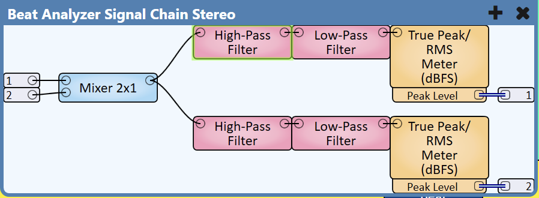

# Beat Analyzer – Q-SYS Plugin

Beat and BPM detection from the music running through Q-SYS, with **tempo sync to a
grandMA2 or grandMA3 speed master**. The plugin reads level meters on the kick (and
optionally the snare), finds the tempo and keeps a beat clock running – also through
breakdowns. Every output is a plain Q-SYS control with its own pin.

Part of [levo AVL Q-SYS Plugins](../README.md).

<a href="https://github.com/levoavl/qsys-plugins/releases/download/beatanalyzer-v1.0/levo-beatanalyzer.qplug"></a>
<a href="CHANGELOG.md"></a>

## Tested on

| Setup | Q-SYS | Result |
|---|---|---|
| Core 24f, kick + snare meters, web radio stream (pop) and DJ music, grandMA2 3.9.60.91 via Telnet | Designer 10.1 | ✅ tempo lock, beat LED, speed master sync |
| Emulation with the built-in test generator | Designer 10.1 | ✅ |
| grandMA3 (OSC) | – | not tested yet |

## How it works

Q-SYS scripts cannot see audio samples, so the analysis is split:

1. **DSP (in your design):** music feed → mono sum → band-pass filters → **meters**.
2. **Plugin:** reads the meters every 10 ms and
   - detects onsets (level jumps above an adaptive threshold – independent of the volume),
   - finds the tempo with a histogram of the intervals between onsets (folded into the
     BPM range by octaves),
   - refines it by linear regression over the last beats – far more exact than a single
     meter update,
   - runs a beat clock that follows the kicks and keeps going when they stop.
3. **Console:** the tempo is set on the speed master directly (`Master 3.1 At BPM 128`),
   not tapped – so network jitter does not reach the lights. A new value is only sent
   when the tempo is locked and has changed.

Works best with 4/4 music with a steady beat (house, techno, pop, hip-hop). With live
bands or music without a steady beat the plugin locks less reliably; it then holds the
last good tempo instead of sending wrong values.

## Design setup

The plugin needs the levels of a kick band and – optionally – a snare band. A ready-made
signal chain for this is included as a Q-SYS user component.

### Ready-made signal chain (user component)

<a href="https://github.com/levoavl/qsys-plugins/releases/download/beatanalyzer-v1.0/levo-beatanalyzer-signal-chains.quc"></a>

`levo-beatanalyzer-signal-chains.quc` contains two containers – use the one that matches
your feed and delete the other:

| Container | Input | Outputs |
|---|---|---|
| **Beat Analyzer Signal Chain Mono** | 1 (mono) | 1 = kick level, 2 = snare level |
| **Beat Analyzer Signal Chain Stereo** | 1 = L, 2 = R (summed to mono) | 1 = kick level, 2 = snare level |



1. Copy the `.quc` file into your Q-SYS user components folder
   (`Documents\QSC\Q-Sys Designer\User Components`) and restart Designer – it appears in the
   Schematic Library under *User Components*. You can also drag it from the folder onto the
   schematic.
2. Feed the container's input(s) with the signal that goes to the amplifiers.
3. Wire **output 1 → `Kick Level`** and **output 2 → `Snare Level`** of the Beat Analyzer.
   Set the plugin property `Inputs` to *Kick + Snare*. With *Kick* only, leave output 2 open.

What is inside (each branch: high-pass → low-pass → True Peak/RMS meter, peak level out):

| Branch | High-pass | Low-pass | Meter |
|---|---|---|---|
| Kick | 40 Hz, Linkwitz-Riley 24 dB/oct | 120 Hz, Linkwitz-Riley 24 dB/oct | Peak, response 100 ms |
| Snare | 120 Hz, Linkwitz-Riley 24 dB/oct | 400 Hz, Linkwitz-Riley 24 dB/oct | Peak, response 80 ms |

### Notes for your own chain

- **Tap point:** the feed that goes to the amplifiers, before the system limiter/compressor
  if possible – they flatten the kick.
- **No AGC / compressor in the branch.** The detection works on level rises in dB and is
  independent of the volume; a gain control only smooths the rises it needs.
- **Filters:** steep (Linkwitz-Riley 24 dB/oct or more). The kick high-pass keeps sub bass
  out, which would otherwise hold the level up between the kicks.
- **Meter:** the level must drop clearly between two kicks. Shorter response = faster drop.
  On the Debug page `Onset Strength` should jump clearly on each kick and fall in between;
  if the Onset LED flickers between beats, the response is too short.
- **Snare input:** recommended for pop, rock and live bands, where the kick alone is
  syncopated or weak. `Snare Weight` sets how much it counts. A hi-hat band works as well.
- **Wired Pin** (default): wire the meter peak level pins to `Kick Level` / `Snare Level`.
- **Named Component:** give the meters a Code Name, enable *Script Access*, and enter the
  names on the Setup page (control name usually `meter.1`).

The Debug page shows `Level Updates` – how often the level actually changes per second.
20/s or more is good.

## Console setup

### grandMA2 (Telnet)
1. **Setup → Console → Global Settings → Telnet = "Login Enabled"**.
2. Use a user that is allowed to run commands and enter it on the Setup page
   (default `administrator`).
3. The Core must reach the console on **TCP 30000**.
4. Default command: `SpecialMaster 3.{master} At {bpm}` – the MA2 speed mode must be set
   to BPM. Change the command on the Setup page if needed.

### grandMA3 (OSC)
1. **Menu → In & Out → OSC:** add a line with the console's IP, port (default 8000),
   *Enable Input* and **Receive Command = Yes**. Optional prefix (e.g. `gma3`).
2. Enter IP, port and prefix on the Setup page.
3. Default command: `Master 3.{master} At BPM {bpm}`.
4. MA3 sends no reply over OSC – the plugin cannot confirm that commands arrive.

On the console, assign the speed master to the chasers and effects that should follow
the music.

## Properties

| Property | Values | Default | |
|---|---|---|---|
| Level Source | Wired Pin / Named Component / Test Generator | Wired Pin | Where the levels come from. Test Generator simulates kick and snare (for Emulation). |
| Inputs | Kick / Kick + Snare | Kick | Analyse a snare input together with the kick |
| Console Type | None / grandMA2 / grandMA3 | grandMA2 | Where the tempo goes. None = pins only. |
| Debug Print | None / Basic / Verbose | None | Verbose logs every onset and every command |

## Controls

### Control page – tempo overview

| Control | Type | Pin | |
|---|---|---|---|
| BPM | Float | out | Current tempo, exact (0 = none yet) |
| BPM Text | Text | out | Tempo as shown (whole numbers with `Whole BPM`), `---` without tempo |
| Beat | LED | out | **Blinks on every beat** – keeps blinking in breakdowns |
| Downbeat | LED | out | Beat 1 of the bar |
| Bar 1–4 | LED | out | Position in the bar |
| Bar Position | Integer 1–4 | out | Position in the bar |
| Locked | LED | out | Tempo is stable and good enough to send |
| Detection State | Text | out | `Searching` / `Locked` / `Free Running` / `No Signal` / `Hold` / `Tap` / `Manual` |
| Confidence | Meter 0–100 % | out | How clearly one tempo wins |
| Kick Meter | Meter dB | out | Kick level seen by the detection |
| Tap | Trigger | in | Tap the tempo. The first tap is beat 1. With Auto on, the tap also tells the detection which octave you want. |
| Auto | Toggle | in/out | Off = manual: only Tap sets tempo and phase |
| Hold | Toggle | in/out | Freeze the tempo, send nothing new |
| Half / Double | Trigger | in | Tempo ×½ / ×2 (octave errors) |
| Resync | Trigger | in | The next kick becomes beat 1 |
| Shift Half Beat | Trigger | in | Beat sits on the offbeat → move it half a beat |
| Tempo Scale | Text | out | Current ×½/×2 factor |
| Send Enable | Toggle | in/out | Send the tempo to the console |
| Send Now | Trigger | in | Send the current tempo right away |
| Last Sent | Text | out | Last tempo sent |
| Status | Status | out | Console connection and input state |

### Setup page

| Control | | Default |
|---|---|---|
| Kick Level / Snare Level | dB input pins (Wired Pin source) | |
| Kick Component / Kick Control | Named Component source, kick meter | – / `meter.1` |
| Snare Component / Snare Control | Named Component source, snare meter | – / `meter.1` |
| Snare Weight | How much the snare input counts | 50 % |
| Snare Meter | Snare level seen by the detection | |
| BPM Min / BPM Max | Tempo range, at least one octave. Tempos outside are folded in (174 → 87). | 80 / 160 |
| Sensitivity | Higher = smaller level jumps count as beats | 50 % |
| Min Confidence | Below this the tempo is not sent | 50 % |
| Beat Offset (ms) | Positive = beat outputs earlier (meter and network latency) | 0 |
| IP Address / Port | Console | – / 30000 (MA2), 8000 (MA3) |
| Username / Password | MA2 Telnet login | administrator / – |
| OSC Prefix | MA3 | – |
| Speed Master | Speed master number | 1 |
| Command Template | `{master}` and `{bpm}` are replaced | see above |
| Send Hysteresis | Minimum tempo change before a new value is sent (BPM) | 0.5 |
| Whole BPM | Send and display whole numbers (a new value only past ±0.7 BPM); the BPM pin stays exact | on |
| Connected / Logged In / Reconnect | MA2 connection | |

### Debug page

`Level Updates`, `Onset`, `Onset Strength`, `Onset Threshold`, `Onset Count`,
`Tempo Candidates` (strongest histogram peaks), `Last Command`, `Last Reply` (MA2),
`Last Error`. With the Test Generator: `Test BPM`, `Test Jitter`, `Test Dropout`,
`Test Update` (simulated meter interval) and `Test Breakdown`.

## Status

| Status | Meaning |
|---|---|
| OK | Console ready (MA2: logged in; MA3: socket open) or detection only |
| Compromised | Console OK, but no level updates / meter not found |
| Fault | MA2 login failed, MA3 UDP socket error |
| Missing | No IP address, or connection lost (retry with backoff 1 → 30 s) |
| Initializing | Connecting / logging in |

## Source code

Sources and offline tests (mocked Q-SYS runtime, simulated kick and snare patterns, fake
MA2 Telnet server, MA3 OSC packet check) are in
[source/plugins/beatanalyzer](../source/plugins/beatanalyzer):

```
python3 source/tools/build.py beatanalyzer --check
python3 source/plugins/beatanalyzer/test/harness.py
```
